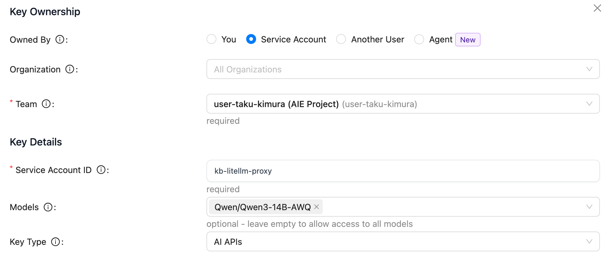
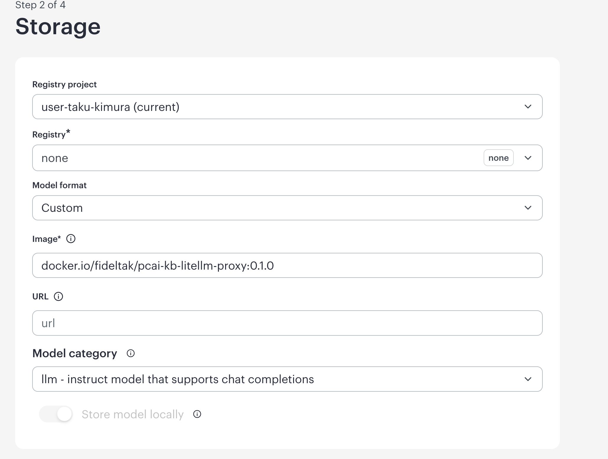
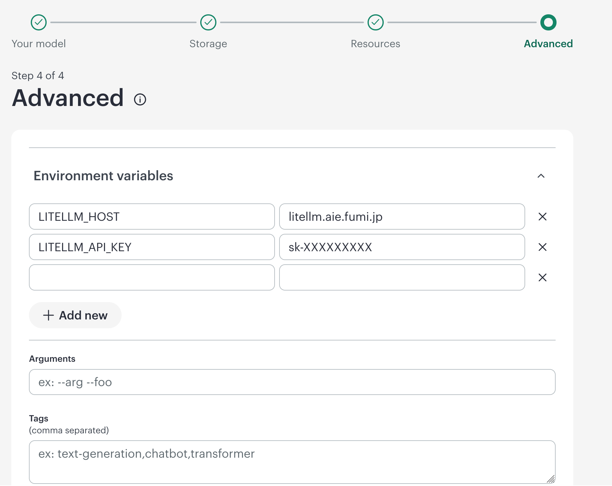
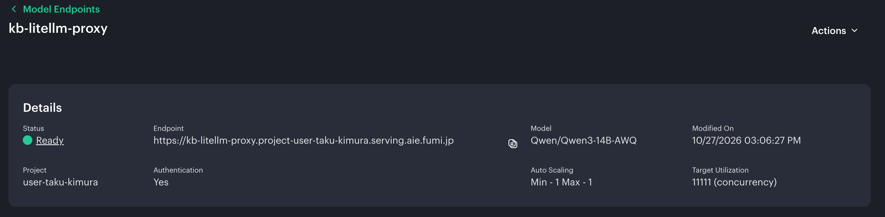
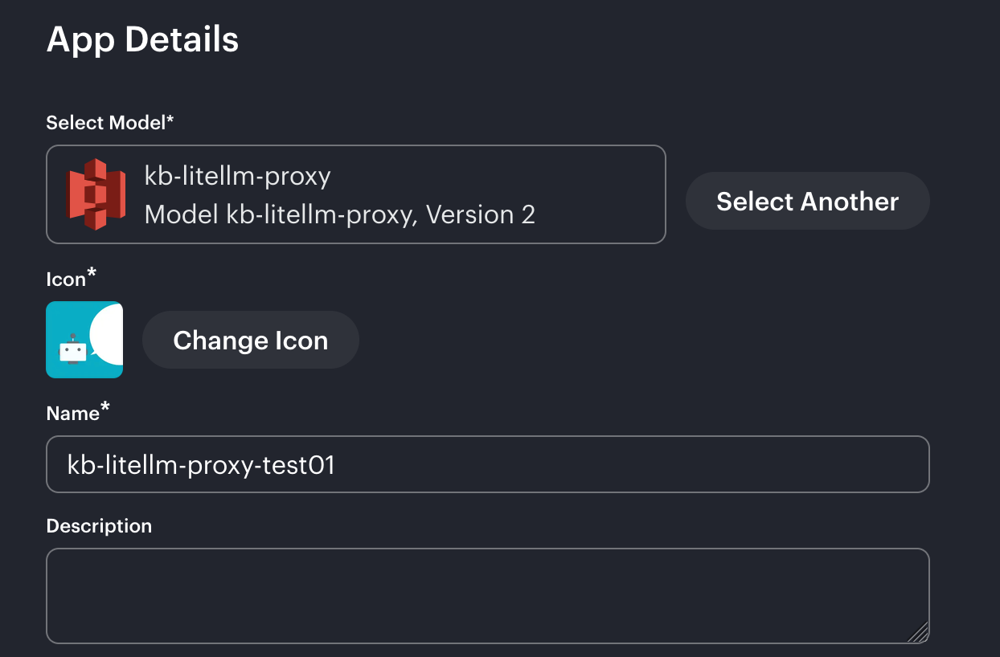
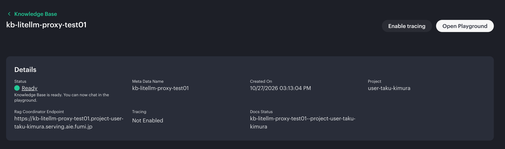
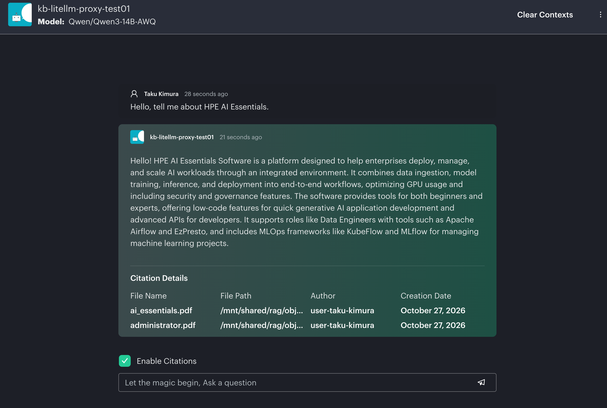

# Connecting between HPE PCAI Knowledge Base and LiteLLM
This proxy is for connecting to LiteLLM from HPE PCAI Knowledge Base.

## Installation
### LiteLLM
First, you need to create a token in LiteLLM that will be used by this proxy.

**IMPORTANT**: Do not configure multiple models, as HPE AI Essentials does not support recognizing multiple models.

### HPE MLIS
Creating a Packaged Model for This Proxy

You need to specify the container image as **docker.io/fideltak/pcai-kb-litellm-proxy:tag** and set the model category to **llm**.

Then configure some env values.
| Key | Example Value | Description |
| ---- | ---- | ---- |
| LITELLM_HOST | litellm.aie.example.com | The URI of Litellm |
| LITELLM_API_KEY | sk-YOUR-LITELLM-TOKEN | The token for Litellm |

After deploying the model service, check the model name displayed on the HPE AIE dashboard. It should match the model name you configured in LiteLLM.

### HPE Knowledge Base
Now you can select the proxy that exposes the model service through LiteLLM.

